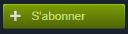
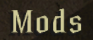
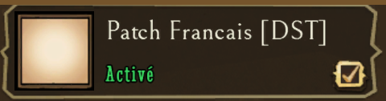
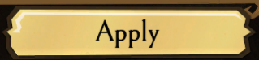
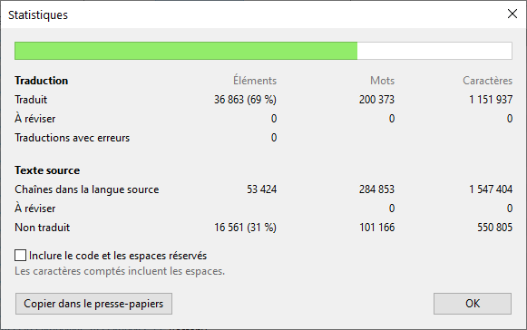

Traduction en Français pour le jeu Don't Starve Together.

### Table des matières
**[Installation](#installation)** 
**[Désinstallation](#d%C3%A9sinstallation)** 
**[Installation (manuel)](#installation-manuel)** 
**[Désinstallation (manuel)](#désinstallation-manuel)** 
**[Télécharger](#t%C3%A9l%C3%A9charger-la-derni%C3%A8re-version)** 
**[Statistique](#statistique)** 
**[Contact](#contact)** 

## Installation:
1) Allez sur le steam Workshop **https://steamcommunity.com/sharedfiles/filedetails/?id=1462877774**
2) Abonnez-vous au mod et cliquer sur le bouton 
3) Lancez le jeu et allez dans le menu 
4) Cochez le mod 
5) Cliquez sur 
6) Le jeu va redémarrer en français.

## Désinstallation:
1) Allez sur le steam Workshop **https://steamcommunity.com/sharedfiles/filedetails/?id=1462877774**
2) Désabonnez-vous du mod et cliquez sur le bouton 

**⚠️** Si vous ne pouvez pas utiliser le Workshop Steam, utilisez la méthode manuelle. **⚠️**

## Installation (Manuelle):
1) **[Téléchargez la dernière version](../../archive/master.zip)** 
2) Localisez le dossier d’installation de votre jeu Don't Starve Together.
    - Par défaut, il se trouve dans : `C:\Program Files (x86)\Steam\steamapps\workshop\content\322330`
    - Si votre Steam ou jeu est installé ailleurs, cherchez ce chemin dans votre dossier Steam (l'important est de trouver le dossier `steamapps\workshop\content\322330`).
3) Placez le dossier du mod `1462877774` dans ce dossier `322330`.
4) Cochez le mod 
5) Cliquez sur 
6) Le jeu va redémarrer en français.

## Désinstallation (Manuel):
1) Localisez le dossier d’installation de votre jeu Don't Starve Together.
    - Par défaut, il se trouve dans : `C:\Program Files (x86)\Steam\steamapps\workshop\content\322330`
    - Si votre Steam ou jeu est installé ailleurs, cherchez ce chemin dans votre dossier Steam (l'important est de trouver le dossier `steamapps\workshop\content\322330`).
2) Dans le dossier du jeu `322330` supprimer le dossier mod `1462877774`.
3) Redémarrer le jeu.

## Télécharger la dernière version

## Statistique

## Contact

